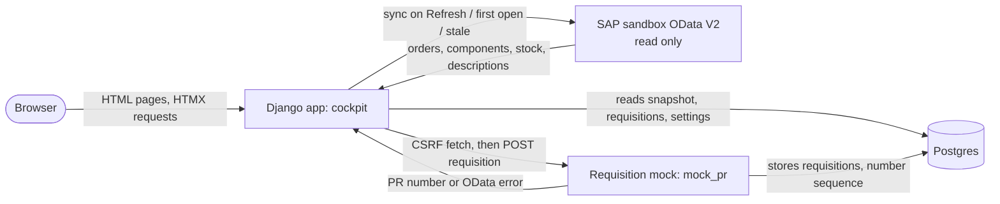

# Material Shortage Cockpit architecture

Status: Proposed. Built today: an empty Django project with CI on Postgres (#4, #9), the requisition mock (#8) and the SAP read client with its read functions (`sap/`, #18). Not built yet: everything in this document beyond that.

## Intended system

One Django web app with server-rendered templates and HTMX reads production orders, components, stock and material descriptions from the SAP sandbox (OData V2, read only), stores them as a per-plant snapshot in Postgres, and calculates shortage statuses from that snapshot on every page view. Purchase requisitions are sent to a separate mock service that behaves like SAP's purchase requisition API. Postgres is the source of truth for requisitions and settings; SAP is the source of truth for orders and stock.

Trust boundary: SAP and the mock are external systems reached over HTTPS with an API key; the browser only talks to the Django app, which checks login and role on every request.

## Responsibilities

| Part | Owns | Must not |
|---|---|---|
| `cockpit/` (Django app) | Models, views, templates, URLs, role checks | Put business logic in views or templates |
| `cockpit/services/` | Plain, tested functions: allocation and status (`shortage.py`), unit conversion (`units.py`), sync (`sync.py`), requisitions (`requisitions.py`) | Import Django views or HTTP request objects |
| `sap/` | OData V2 client: build URLs from `SAP_BASE_URL`, send the `APIKey` header, `$filter`/`$expand`/paging, map errors; requisition client for the mock (CSRF fetch + POST) | Write to the SAP sandbox; know about Django models |
| `mock_pr/` | Standalone FastAPI mock of `API_PURCHASEREQ_PROCESS_SRV` (#8), used by both PoC tracks | Import the Django app, or be imported by it |
| Postgres | App data in the default schema; mock data in schema `mock_pr` | |

Dependencies point inward: views → services → `sap/` and models. Services take plain values and return plain values where possible, so they can be unit-tested without SAP or a browser.

## Data model

Snapshot (owned by SAP, refreshed by sync, never edited in the app):

- **PlantSnapshot**: plant, synced_at, last_sync_error, last_sync_error_at.
- **ProductionOrder**: plant, order number (unique), material, material description, quantity, unit, start date, is_active (false when no longer released in SAP), synced_at.
- **Component**: order (FK), item number, material, description, required quantity, withdrawn quantity, unit.
- **Stock**: plant, material, unrestricted quantity (summed over storage locations), stock unit, safety stock (change request), standard price per stock unit and currency (change request, empty when SAP has no price), synced_at. Unique on plant + material.

Owned by the app:

- **Requisition**: order (FK, protected: an order with requisitions is never deleted), material, item numbers of the order's lines for that material (at request time), quantity entered + unit entered, quantity sent + stock unit, shortage at request time (order unit), delivery date, status (`awaiting_approval`, `sent`, `failed`, `rejected`), PR number, payload sent (JSON), response (JSON), error message (text), created_by, created_at, decided_by, decided_at, reject_reason, sent_at. The app reference `REQ-n` is not stored: it is `REQ-` + the id, unpadded (`REQ-16`). Database constraint: at most one requisition per order + material with status `awaiting_approval` or `sent`; failed and rejected rows never block, and a retry is a new row. Sending happens in one transaction: insert as `sent` with no PR number, POST, then store the PR number or switch to `failed`. A parallel second request blocks on the uncommitted row and then fails, so it never reaches the mock.
- **BufferChange**: a log with one row per change of the cover buffer: value (0–100, 2 decimals), changed_by, changed_at. The current buffer is the newest row, or 10 when there is none. Changing it from the screen is the change request (REQ-9).

Safety stock and prices come from SAP and live in the snapshot; the approval limit is a constant in code (`APPROVAL_LIMIT`). None of them is edited in the app.

Not stored: statuses, available stock and shortages. They are calculated from the snapshot and settings on every view, so they can never go stale relative to the data shown.

All quantities are `DecimalField(max_digits=15, decimal_places=3)` / `Decimal`, matching the 3 decimals of SAP's requisition quantity; a quantity converted to the stock unit is rounded up to 3 decimals before it is sent and stored. Units are SAP unit codes as returned by the sandbox; the codes are confirmed by the sandbox data check (#7).

## Critical flows

**Sync (Refresh, first open of a plant, or snapshot older than 5 minutes).** Runs inside the request, with an HTMX loading indicator.
1. Read all released open orders of the plant with their components in one call (release filter and fields in [docs/sandbox/findings.md](docs/sandbox/findings.md)), following `__next` links if SAP ever pages.
2. Read stock for all component materials of the plant in batches of 40 materials, and material descriptions. Change request: also safety stock (`A_ProductSupplyPlanning`) and prices (`A_ProductValuation`), about 0.5 s per call.
3. In one database transaction: update existing orders, add new ones, mark orders not returned as inactive (their requisitions keep their link), replace stock rows, set synced_at.
4. On any SAP error: roll back, keep the previous snapshot, store the error on PlantSnapshot. The page shows a warning banner with the last successful sync time, or an error page if there was never a successful sync.

**Status calculation** (`services/shortage.py`, pure function). Input: active orders of the plant up to the end of the selected range, their components, stock, settings. Sort orders by start date, then order number. For each material keep a running balance in the stock unit, starting at stock − safety stock (never below 0; safety stock is 0 before the change request); for each component convert the open requirement to the stock unit, compute available, shortage and status, then subtract the requirement (not the buffer) from the balance. Order status = worst component status. Unit mismatches are skipped from the balance and reported as such. Component lines of the same material within one order are allocated one after the other in item-number order.

**Create requisition.**
1. Planner clicks Request; the confirm form shows the prefilled shortage in the order's unit and the converted stock-unit quantity.
2. On submit the server re-checks the role, the quantity rules and the one-per-order-and-material constraint.
3. (Change request) If the value (quantity in stock unit × price per stock unit) is above `APPROVAL_LIMIT` (10,000 in the plant's currency), or the material has no price: store as `awaiting_approval` and stop.
4. Otherwise the `sap/` requisition client fetches a CSRF token, POSTs the payload (fixed header constants from #8) and stores the outcome as `sent` with the PR number or `failed` with the error. Then the plant is re-synced.

**Invariants every feature must follow**

| ID | Rule | How it is checked |
|---|---|---|
| INV-1 | A Viewer (or Admin) can never create a requisition, also not by a direct POST | Test posts to the create endpoint as Viewer and Admin and expects 403 |
| INV-2 | No secrets in code or in the repository | Secret scanning with push protection on the repo; review |
| INV-3 | The SAP connection and requisition endpoint come from environment variables only (`SAP_BASE_URL`, `SAP_API_KEY`, `MOCK_PR_BASE_URL`, `MOCK_API_KEY`) | Test with overridden settings; review: no URLs or keys in code |
| INV-4 | The app never sends a write request to SAP; the requisition endpoint is the only POST target | Test: the SAP read client exposes no write method; review |
| INV-5 | Quantities are `Decimal` end to end, never float | Unit tests on boundary values (e.g. 110.000 vs 109.999); review |
| INV-6 | A status depends only on the plant's data and settings, never on the date filter | Test: narrowing the range does not change any shown status |
| INV-7 | At most one requisition per order + material that is awaiting approval or sent | Database constraint plus test |
| INV-8 | A Manager can never approve a requisition they created | Test with Manager A creating and approving (expect 403) and Manager B approving (expect success) |
| INV-9 | Every page requires login, and every permission is checked on the server | Test: anonymous requests redirect to login; forbidden actions return 403 |

## Security and operations

- **Auth:** Django's built-in authentication. One group per role (Viewer, Planner, Manager, Admin); each user is in exactly one group. Permissions are explicit per group, not inherited. Admin uses the built-in Django admin for users and groups only; business models are not registered in it.
- **Secrets:** environment variables locally (`.env`, git-ignored), GitHub Actions secrets in CI, Render environment variables when hosted.
- **Hosting:** Render free tier. One web service for the app (built on day 2), one for the mock, and one free Postgres shared by both in separate schemas. The app runs under gunicorn, WhiteNoise serves its static files, and `DJANGO_HTTPS=true` makes it trust Render's HTTPS proxy; the steps are in the README ("Deploy on Render"). Free services sleep after 15 minutes idle and take about a minute to wake; the free database expires 30 days after creation and has no backups.
- **CI:** GitHub Actions on every PR: ruff, Django checks, migrations check, pytest against a Postgres service, the mock's tests, and Playwright for a few browser flows. Branch protection requires CI to pass before merging.
- **Monitoring and recovery:** none beyond Render's logs. All SAP data can be rebuilt by a sync; requisitions are lost only if the free database expires.

## Decisions

| Decision | Chosen | Instead of | Why | Cost |
|---|---|---|---|---|
| UI | Server-rendered Django templates + HTMX | React SPA | One language and one codebase a Mendix developer can review | Less rich client-side interaction |
| Database | Postgres everywhere | SQLite locally | Exact `Decimal` behaviour must match between tests and hosting | Docker needed locally |
| SAP data | Per-plant snapshot with full sync | Live SAP calls per page; fetching only new orders | Fast pages; statuses never stale silently | 5 s budget applies to a full sync |
| Sync execution | Synchronous, in the request | Background worker (Celery/Redis) | No extra moving parts to host or explain | A slow SAP response blocks that request |
| Statuses | Calculated on read | Stored | Always consistent with the data shown | Recalculated on every view (cheap at this size) |
| Cover buffer | Log table, current value = newest row (Proposed, #21) | One settings row with the last change | Keeps every change with who and when; no singleton row to seed | One query per read |
| Requisition reference | `REQ-n` derived from the id, unpadded (Proposed, #21) | A stored sequence number | Unique and ordered with no locking code | Numbers can have gaps |
| Duplicate PR guard | Insert as `sent`, then POST, in one transaction (Proposed, #21) | A `sending` status; insert after the POST | The database constraint blocks a double submit before the mock is called | Transaction open during the HTTP call (max 10 s) |
| Requisition target | Separate mock service with SAP-identical paths | Mock inside the Django app | Shared by both tracks; switching to real S/4 is a URL change | One more service to deploy |
| Hosting | Render free tier | Azure; paid plans | Simple, free, enough for demo and jury | Sleep and wake-up delay; database expires after 30 days |

## Configuration

- `COCKPIT_PLANTS`: comma-separated plants for the selector, default `AUC1` (findings from #7: most released open orders, all three colours at component level, loads in 2–4 s). USC1 and DEC1 also fit the 5 s target; 1710 does not without fewer, larger calls.
- `SAP_BASE_URL`, `SAP_API_KEY`, `MOCK_PR_BASE_URL`, `MOCK_API_KEY` (INV-3).

## Open decisions

None. SAP fields, the release filter, the start-date field and the default plant were closed in #12 from the sandbox data check.
