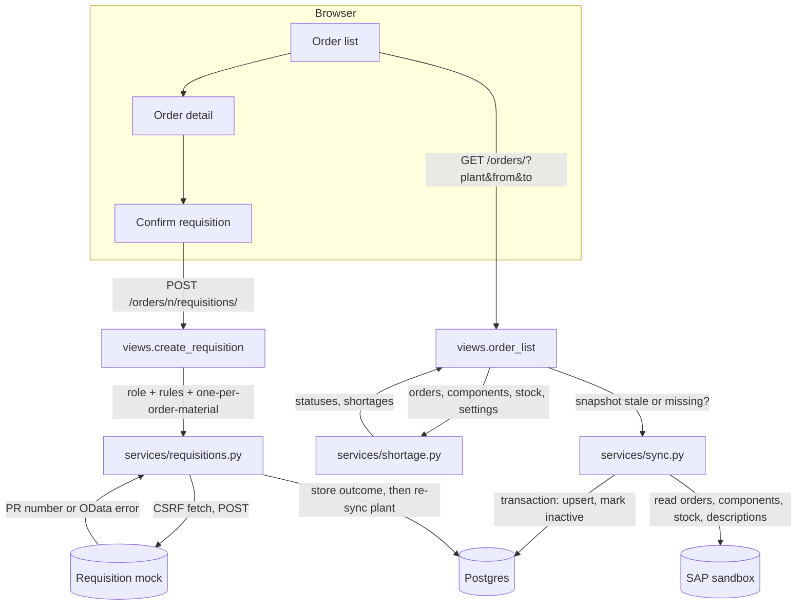

# Material Shortage Cockpit

Status: Proposed

## Problem

Production planners cannot see, in one place, which released production orders will run short of components, because stock is consumed by earlier orders first and shortages show up only when an order is about to start. Replenishment is requested by hand outside the planning view. The cockpit shows each order's risk based on stock allocated by start date, and lets a planner request a purchase requisition in one step. A day-2 change request adds safety stock, an editable buffer and approval of large requisitions.

## User stories

This spec delivers every story in [REQUIREMENTS.md](../../REQUIREMENTS.md): REQ-1 to REQ-7 on day 1, REQ-8 to REQ-10 as the change request on day 2. Roles and permissions are defined there. What the user sees:

- **Success:** order list with coloured statuses, an order page with components, stock and shortage, a confirm step and a PR number after requesting.
- **Denial:** an "access denied" page (HTTP 403) for any action the role does not allow; the Request and approval buttons are not shown to roles that cannot use them.
- **Invalid input:** the confirm form re-shows with a message next to the field (quantity ≤ 0, more than 3 decimals, not a number; buffer outside 0–100).
- **Failure:** SAP unreachable → last data with a warning banner, or an error page on a first load; requisition endpoint error → the SAP error message, the attempt stored, and a Retry button.

## Technical design

The flow and the system boundaries follow [ARCHITECTURE.md](../../ARCHITECTURE.md); invariants INV-1 to INV-9 are defined there and apply to every task below.

### Modules

| Module | Contents |
|---|---|
| `sap/client.py` | `ODataClient(base_url, api_key)`: GET with `APIKey` header, `$filter`, `$expand`, `$select`, paging via `$top`/`$skip` until exhausted; raises `SapUnavailable` on network errors, timeouts (10 s per call) and non-2xx responses. No write methods (INV-4). |
| `sap/production_orders.py`, `sap/stock.py`, `sap/products.py` | One read function per API returning plain dataclasses. Field names, the release filter and the start-date field come from `docs/sandbox/findings.md` (#7). |
| `sap/requisitions.py` | `create_requisition(payload) -> RequisitionResult`: GET with `X-CSRF-Token: Fetch`, then POST to `A_PurchaseRequisitionHeader` on `MOCK_PR_BASE_URL` with `MOCK_API_KEY`; returns the PR number or the OData error message. |
| `cockpit/services/units.py` | `convert(quantity: Decimal, from_unit, to_unit) -> Decimal` for mass (G, KG, T), volume (ML, L, M3) and length (MM, CM, M) with exact factors; raises `UnitMismatch` otherwise. Unit-code aliases from #7. |
| `cockpit/services/shortage.py` | `calculate(orders, stock, settings) -> PlantResult`: the allocation and status rules of REQ-4, pure function, no database access. Returns per component: open requirement, available, shortage, status, tooltip text; per order: worst status, overdue flag, mismatch badge. |
| `cockpit/services/sync.py` | `sync_plant(plant)`: calls `sap/`, writes the snapshot in one transaction (ARCHITECTURE.md, Sync flow); `ensure_fresh(plant)` syncs when missing or older than 5 minutes. |
| `cockpit/services/requisitions.py` | `prepare(order, material)` (prefill), `create(user, order, material, quantity, unit)`, and for the change request `approve(user, requisition)` and `reject(user, requisition, reason)`. All rules live here; views only call them. |
| `cockpit/models.py` | Models from ARCHITECTURE.md, Data model. Constraint for INV-7 as a conditional unique constraint. |
| `cockpit/views.py`, `cockpit/urls.py`, `templates/cockpit/` | Thin views with `login_required` and a role check per view. HTMX for Refresh, the confirm step and tooltips. |
| `cockpit/management/commands/create_test_users.py` | Creates the groups and one user per role plus a second Manager, with passwords from environment variables, for local use, CI and the jury. |

### Pages and URLs

| URL | Who | What |
|---|---|---|
| `/` | business roles | Redirects to `/orders/` |
| `/orders/?plant=&from=&to=&page=` | Viewer, Planner, Manager | Order list (REQ-1). Plant selector from `COCKPIT_PLANTS`; defaults today → +14 days; 50 per page; overdue orders listed first with a badge |
| `POST /plants/<plant>/refresh/` | Viewer, Planner, Manager | Full sync, then reloads the list (HTMX) |
| `/orders/<number>/` | Viewer, Planner, Manager | Components, stock and statuses (REQ-2 to REQ-4); Request button or "Requested: PR …" per material |
| `GET/POST /orders/<number>/requisitions/?material=` | Planner, Manager | Confirm step and create (REQ-5, REQ-10) |
| `/requisitions/` | Viewer, Planner, Manager | All requisition attempts (REQ-5) |
| `/dashboard/?plant=&from=&to=` | Viewer, Planner, Manager | REQ-6 |
| `/settings/` | Manager | Cover buffer, safety stock and approval threshold per material (REQ-8, REQ-9, change request) |
| `/approvals/`, `POST /approvals/<id>/approve`, `POST /approvals/<id>/reject` | Manager | Approval queue (REQ-10, change request) |
| `/admin/` | Admin | Django admin: users and groups only |
| `/accounts/login/`, `/accounts/logout/` | everyone | Django auth views |

### Requisition payload

One header with one item, sent in the stock unit. Item fields: material, plant, requested quantity (converted to the stock unit, `Decimal` as string), base unit (stock unit), delivery date (order start date, or today if past). Header and item constants the cockpit cannot derive (requisition type, purchasing group, and any other required field) are taken from `mock_pr/README.md` (#8) and kept in one module-level constant in `sap/requisitions.py`.

### Status tooltips

- Red: "Short by <shortage> <unit>. Available after earlier orders: <available> <unit>."
- Amber: "Covered, but with less than a <buffer>% buffer (<available> available for <required> needed)."
- Green: "Covered with at least a <buffer>% buffer."
- Unit mismatch: "Order unit <A> and stock unit <B> cannot be compared."
- Change request: when safety stock reduced the available stock, add "Includes safety stock of <n> <unit>."

### Decisions a reviewer could question

| Choice | Reason | Cost |
|---|---|---|
| Statuses calculated on every view, not stored | Never stale relative to the snapshot shown | Recalculation per request; fine at sandbox size |
| Sync inside the request | No worker to host; the 5 s target bounds it anyway | A slow SAP call blocks that request; the loading indicator shows it |
| Re-sync after every successful requisition | Keeps "Data as of" honest after an action | One extra sync per requisition |
| Requisition rules in a service, not the view | Testable without a browser; INV-1, INV-7, INV-8 enforced in one place | One more layer |

### Tests

- Unit tests (no SAP, no database where possible): `cockpit/tests/test_units.py`, `cockpit/tests/test_shortage.py` with constructed inputs for every boundary, `cockpit/tests/test_requisitions.py` with a fake requisition client.
- Acceptance tests: `tests/acceptance/test_ac_<n>_<short_name>.py`, one per AC-n below, run against the live SAP sandbox and a locally started mock (D-19, D-24). Sandbox-dependent tests assert the rules, not fixed numbers.
- Browser checks (Playwright): tooltips, the confirm step, Refresh, the dashboard.

## Acceptance

| ID | Done when | How to check |
|---|---|---|
| AC-1 | REQ-1: the list shows only active released orders of the selected plant with a start date inside the range (inclusive), plus overdue ones | Acceptance test against the sandbox: every shown order is released per SAP and in range or overdue; none outside |
| AC-2 | REQ-1: without parameters, the range is today to today + 14 days and the plant is the first in `COCKPIT_PLANTS` | Test with a fixed clock |
| AC-3 | REQ-1: overdue orders show an "overdue" badge and are listed before the range | Test with a constructed snapshot |
| AC-4 | REQ-1: "Data as of" shows the sync time; Refresh runs a full sync and updates it; a snapshot older than 5 minutes syncs on page load | Test with a fake SAP client and a fixed clock |
| AC-5 | REQ-1: a cold load of the plant completes within 5 s, excluding sandbox outages, single SAP calls over 5 s, and wake-up | Timed manual run on the hosted app, result logged |
| AC-6 | REQ-1: the list shows 50 orders per page; statuses on page 2 match a full calculation | Test with 60 constructed orders |
| AC-7 | REQ-1: when a sync fails, the previous snapshot stays, and a banner shows the last successful sync time | Test with a failing fake SAP client after one successful sync |
| AC-8 | REQ-1: when the first sync of a plant fails, an error page says SAP is unavailable | Test with a failing fake SAP client |
| AC-9 | REQ-1: an order no longer released after a sync is marked inactive, disappears from the list, and keeps its requisitions | Test: sync, create requisition, sync without that order |
| AC-10 | REQ-2: each component shows material, description, required, withdrawn, open requirement and unit | Acceptance test against the sandbox on one order |
| AC-11 | REQ-2: a component with open requirement 0 shows "issued" and has no status | Unit test |
| AC-12 | REQ-3: stock is unrestricted-use stock summed over storage locations; inspection, blocked and special stock are excluded | Unit test on the stock mapping with mixed rows; acceptance test that the shown stock equals the filtered SAP sum |
| AC-13 | REQ-3: stock in a different unit of the same dimension is shown converted, with the original in the tooltip | Unit + browser test (1,500 G shown as 1.5 KG) |
| AC-14 | REQ-4: stock is allocated by start date, then order number. Stock 100, order A (3 Nov, needs 60), order B (4 Nov, needs 60) → A available 100, green; B available 40, red, shortage 20. Equal start dates are ordered by order number | Unit test |
| AC-15 | REQ-4: thresholds for requirement 100: available 99 → red (shortage 1); 100 → amber; 109.999 → amber; 110 → green | Unit test with `Decimal` (INV-5) |
| AC-16 | REQ-4: the buffer is not taken from stock. Stock 215, orders A and B each need 100 → A available 215, green; B available 115 (not 105), green | Unit test |
| AC-17 | REQ-4: an order's status is its worst component status; unit mismatch alone gives a warning badge, not red | Unit test |
| AC-18 | REQ-4 / INV-6: narrowing the date range never changes any status shown | Acceptance test: same order, two ranges, same status |
| AC-19 | REQ-4: 2 KG required with 1,500 G stock → red, shortage 0.5 KG; 10 PC required with stock in KG → unit mismatch | Unit test |
| AC-20 | REQ-4: every status shows a tooltip with the rule and the buffer value | Browser test |
| AC-21 | REQ-5: Planner and Manager see a Request button on short components; Viewer does not | Test per role |
| AC-22 | REQ-5: the confirm step prefills the shortage; 0, negative, non-numeric and 4-decimal values are rejected with a message | Test |
| AC-23 | REQ-5: the payload sends the quantity converted to the stock unit, the stock unit, and the delivery date = start date, or today if past | Unit test on payload building with a fixed clock |
| AC-24 | REQ-5: on success the PR number is stored and shown, the button becomes "Requested: PR <n>, <qty>", and a second request for the same order + material is refused (INV-7) | Acceptance test against the local mock |
| AC-25 | REQ-5: on an endpoint error the error message is shown, the attempt is stored as failed, and Retry creates a new attempt | Test with the mock returning 400 |
| AC-26 | REQ-5: the requisition list shows number, order, material, quantity, unit, delivery date, user, time and outcome for every attempt | Test |
| AC-27 | REQ-5 / INV-3 / INV-4: requisitions are sent only to `MOCK_PR_BASE_URL` with a CSRF token and the `APIKey` header; no request ever writes to `SAP_BASE_URL` | Acceptance test against the local mock; test that the SAP client has no write method |
| AC-28 | REQ-6: the dashboard shows the red order count, shortage per material with affected orders, shortage per order, and unit mismatches separately, matching the order list | Test with a constructed snapshot |
| AC-29 | REQ-7 / INV-9: every URL redirects an anonymous user to login | Test over all URL names |
| AC-30 | REQ-7: Admin can manage users and groups in `/admin/` and gets 403 on business pages; business roles get 403 on `/admin/` user management | Test per role |
| AC-31 | REQ-7 / INV-1: a direct POST to create a requisition as Viewer or Admin returns 403 and stores nothing | Test |
| AC-32 | REQ-8 (change request): a Manager can set, change and remove safety stock per material; the status rule uses it as decided below; the tooltip mentions it | Unit + test per role |
| AC-33 | REQ-9 (change request): a Manager can set the buffer (0–100); statuses and tooltips use it at once; other values are rejected | Unit + test |
| AC-34 | REQ-10 (change request): a requisition above the material's approval threshold is stored as awaiting approval and not sent | Test with the local mock (no POST received) |
| AC-35 | REQ-10: approving sends it and stores the outcome as in AC-24 / AC-25 | Acceptance test against the local mock |
| AC-36 | REQ-10: rejecting requires a reason, shows it to the planner, and allows a new request for that order + material | Test |
| AC-37 | REQ-10 / INV-8: Manager A cannot approve their own requisition (403); Manager B can | Test |
| AC-38 | REQ-10 / INV-7: while a request awaits approval, no second request for the same order + material can be created | Test |

## Out of scope

- Writing to a real SAP system, and any SAP write other than requisitions to the configured endpoint.
- Material-specific unit conversions, editing or cancelling sent requisitions, notifications, background sync.
- Deployment to Render (B-01, day 2) and the requisition mock itself (#8).

## Open decisions

1. **Safety stock rule (REQ-8, AC-32).** Recommended: safety stock is reserved before allocation, so stock available to orders = stock − safety stock (not below 0). Blocks AC-32 only; must be settled before the spec freeze.
2. **Approval threshold (REQ-10, AC-34).** Recommended: per material and plant, in the stock unit, maintained by the Manager on `/settings/`; materials without a threshold never need approval. Blocks AC-34 only; must be settled before the spec freeze.
3. **SAP fields, release filter, start-date field, unit codes and default plant.** Recommended: take them from `docs/sandbox/findings.md` (#7). Blocks the `sap/` modules, not the rules or tests in this spec.
